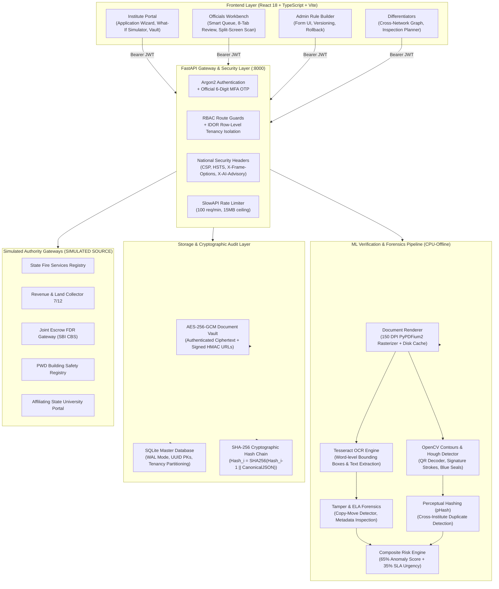

# AICTE SATYAPAN - Complete System Architecture

## 1. System Overview & Statutory Tenets
**AICTE SATYAPAN** is an enterprise-grade AI decision-support and document scrutiny platform designed for the All India Council for Technical Education (AICTE) Extension of Approval (EoA) scrutiny cycle.

It is built strictly under the following statutory principles:
1. **Decision Support Only (Principle 1)**: All AI outputs are strictly advisory. AI never approves, rejects, or sanctions an application. All final statutory decisions are executed exclusively by human officials with mandatory written justification remarks.
2. **Two-Person Rule for Adverse Actions**: Scrutiny officers can directly approve clean applications. Any adverse action (*Reject*, *Raise Deficiency*, *Recommend Physical Inspection*) automatically transitions the dossier to `AWAITING_SENIOR_CONFIRMATION` and requires formal concurrence by an `OFFICIAL_SENIOR` officer before execution.
3. **Explainable AI (XAI)**: Every finding, anomaly flag, and risk score features an Explain-Why factor breakdown with model/rule attribution, inputs used, feature weights, and visual bounding box overlays.
4. **Cryptographic Immutability**: All decisions, document access events, and rule alterations are recorded in a SHA-256 hash-chained audit ledger with real-time tamper detection.
5. **Privacy by Design**: Mandatory purpose-bound access tokens before document viewing, default PII masking (Aadhaar, PAN, Mobile), and dynamic official watermarking under the Indian DPDP Act 2023.

---

## 2. End-to-End System Architecture Diagram



---

## 3. Cryptographic Hash Chain Specification

Every transaction written to the audit log computes a deterministic SHA-256 hash chaining backward to the hardcoded genesis root:

$$\text{Root Hash}_0 = \text{"GENESIS\_ROOT\_HASH\_AICTE\_SATYAPAN\_2026"}$$

$$\text{Hash}_i = \text{SHA-256}\Big(\text{Hash}_{i-1} \,\|\, \text{":"} \,\|\, \text{CanonicalJSON}(\text{Payload}_i)\Big)$$

Where $\text{CanonicalJSON}$ is defined as UTF-8 encoded JSON with sorted keys and compact separators:
```python
json.dumps(payload, sort_keys=True, separators=(',', ':'))
```

Any modification to a past row's details immediately produces a checksum mismatch:
$$\text{Expected Hash}_i \neq \text{Stored Hash}_i$$
The `/audit/verify-chain` endpoint recomputes this sequence from genesis in under 20ms across thousands of records and pinpoints the exact corrupted row ID and index.

---

## 4. Bounding Box & Coordinate Unification Contract

All document overlays (OCR words, extracted form fields, QR decoders, blue seals, signature strokes, and tampered regions) adhere to a unified coordinate space:

- **Origin**: Top-left corner $(0, 0)$ of the rendered document page image.
- **Rendering Resolution**: Standardized at **150 DPI**.
- **Page Dimensions**: Provided alongside bounding box records: `[x, y, width, height, page_width, page_height]`.
- **Frontend Presentation**: Rendered inside a `.stage` `<div>` containing an `` and an overlaid `<svg class="overlay" viewBox="0 0 W H" preserveAspectRatio="none">`.
- **Zoom & Pan**: All transformations (scale, translate, rotate) apply strictly to `.stage` via CSS transforms, guaranteeing pixel-perfect alignment under any viewport scaling.
