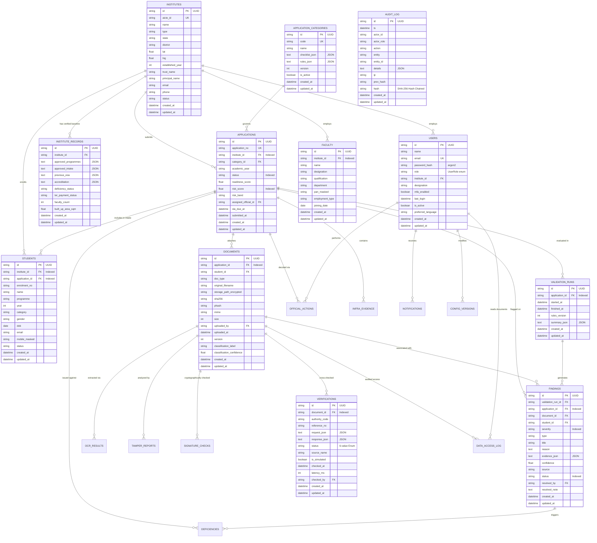

# AICTE SATYAPAN - Entity Relationship Diagram (ERD)

This document details the complete relational data model for the AICTE SATYAPAN platform with UUID primary keys, automated audit triggers, hash-chained logging, and indexing.

